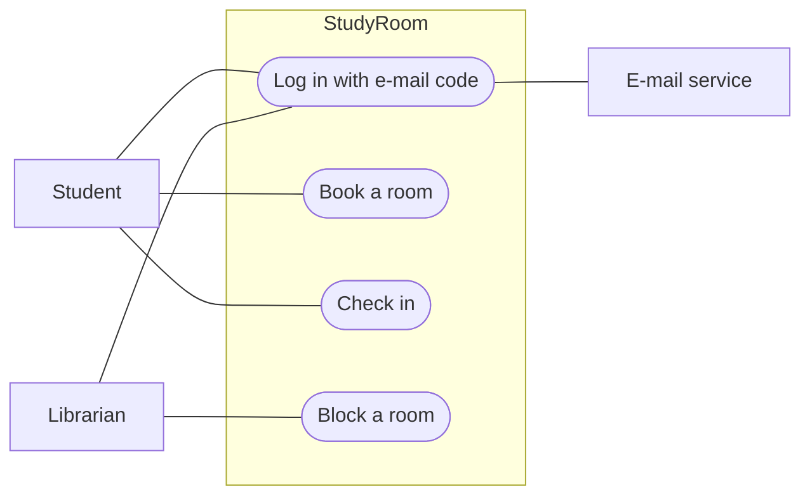

# Software Requirements Specification — *project title*

<!--
WHAT THIS DOCUMENT IS
How people use your product: the scope, the actors, the use cases (with what can go
wrong), the use case diagram and the constraints. PROPOSAL.md says why and what, in a few
paragraphs; this says who does what with the system, step by step. A page or two — not
thirty.

RULES
- Keep the headings. Write under them.
- week02/requirements.json is the only place for the requirements. Do not copy them into
  this file. §4 and §5 hold one line: "The requirements are in week02/requirements.json."
- Each use case names its requirement ids from requirements.json: REQ-001, REQ-002 …
  Ids never change after this week: the chain requirement → use case → screen → test
  case → api.md row points at them.
- The examples in the comments describe one invented project, "StudyRoom" (booking a
  library study room). They show the level of detail wanted; write about your project.
  Comments are invisible on GitHub and not counted by the checker.
-->

## 1. Purpose and scope

<!--
WHAT: two or three sentences — what the system is for, who uses it, and what is outside
it. Copy the "does NOT do" sentence from PROPOSAL.md §4; scope is where it belongs.
EXAMPLE: "StudyRoom lets Atlas University students book the library's twelve study rooms
and lets the librarian manage the bookings. It covers study rooms only; computers, group
spaces, payments and the library catalogue are out of scope."
-->

## 2. Actors

<!--
WHAT: every kind of person and every outside system that interacts with yours, one line
each: who they are and what they want from the system. Include the e-mail service that
sends the login codes, any third-party API, and the app store.
EXAMPLE:
- Student — finds a free room, books it, checks in.
- Librarian — sees the day's bookings, blocks a room for cleaning or an event.
- E-mail service — delivers the login code.
- App store — distributes the mobile app.
-->

## 3. Use cases

<!--
WHAT: at least three use cases. A use case is one thing an actor achieves, from start to
finish — "book a room", not "press the button". Write each one in this shape:

  UC1 — Book a room
  Actor: Student.  Requirements: REQ-002, REQ-003.
  Main flow: 1. The student opens the app, already logged in (UC0).
             2. The app shows today's rooms as free or busy, by hour.
             3. The student picks a free slot of up to two hours and confirms.
             4. The server stores the booking; the slot shows as busy for everyone.
  What can go wrong: the slot was taken a second earlier — the app says so and shows
             the next free slot; the student already has a booking at that time — refused.

Then ONE use case diagram in Mermaid, directly under this comment: the actors outside,
the use cases as rounded nodes UC([…]) inside a box that is your system. The checker counts
the ([…]) nodes: at least three. The block below is an example: replace every line of it
and delete the EXAMPLE line, or the checker treats it as missing.
-->

## 4. Functional requirements

<!--
Nothing to write here. week02/requirements.json is the only place for the functional
requirements (what the system does); do not copy them into this file. Keep the one line
below.
-->

The requirements are in `week02/requirements.json`.

## 5. Non-functional requirements

<!--
Nothing to write here. week02/requirements.json is the only place for the non-functional
requirements (how well the system does it: speed, security, privacy, the phone screen);
do not copy them into this file. Keep the one line below.
-->

The requirements are in `week02/requirements.json`.

## 6. Constraints and assumptions

<!--
WHAT: what you take as given and cannot change — the store you will publish on, the
devices you own, the hosting you can afford, the term calendar, rules of the organisation
(the library's opening hours, say).
EXAMPLE: "Published on Google Play only; I own an Android phone and no Mac. Free hosting
tier (the server may sleep after 15 minutes idle). The library is open 08:30–22:00."
-->
